# Validation & security screenshots (Component 8)

Captured from the running app by `scripts/capture_screenshots.py`.

### Login form: submitting empty fields is rejected in the browser

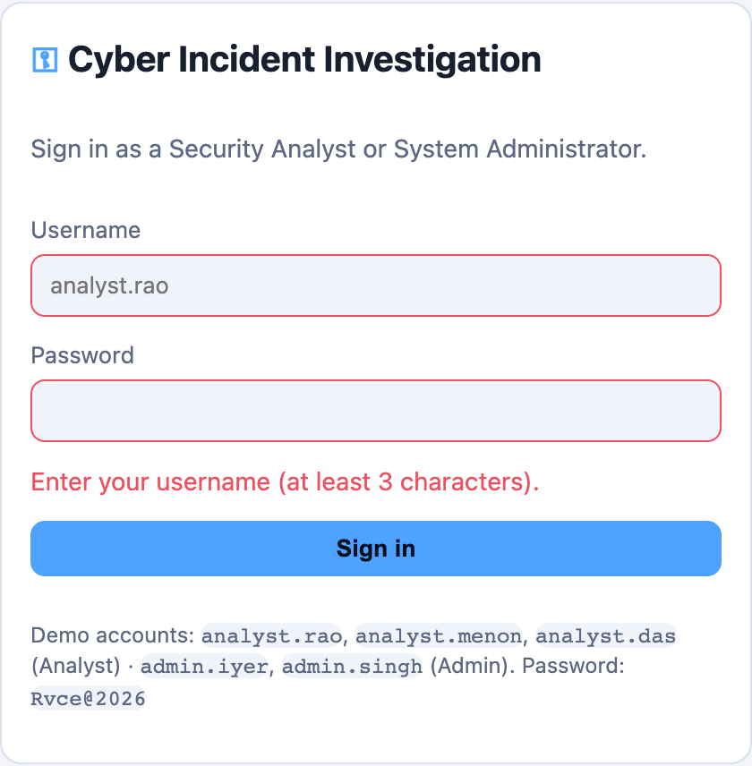

### Login form: wrong password rejected by the server (scrypt hash check)

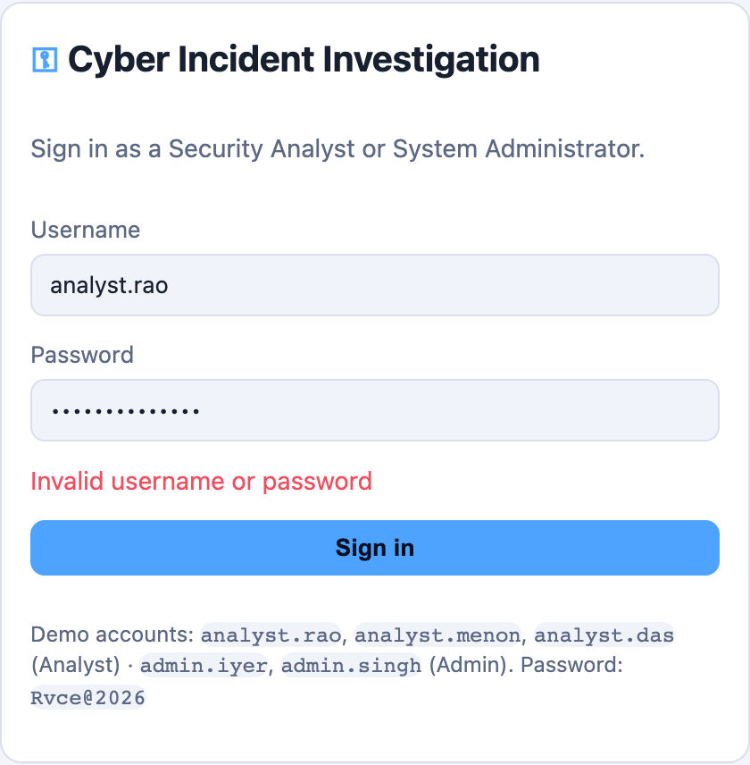

### Brute-force protection: 5 failures in 5 minutes lock the account

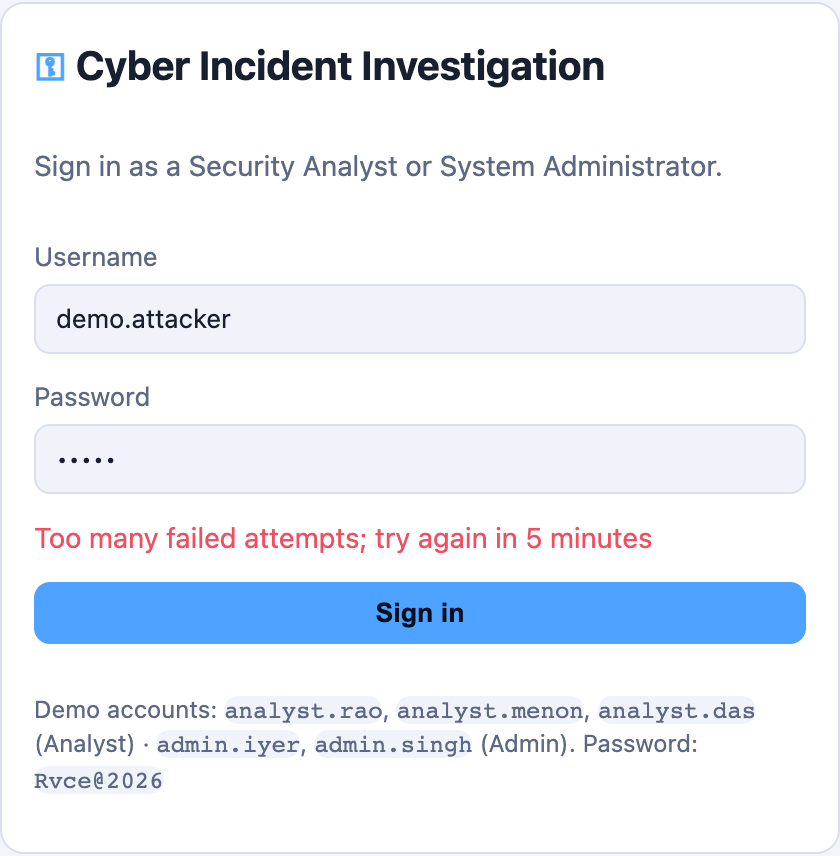

### Admin › Add user: username, email, department and password-strength rules

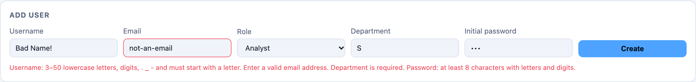

### Admin › Register device: hostname, IPv4, MAC, OS and criticality (1–5) checks

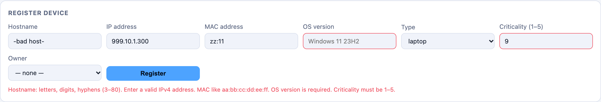

### Server-side validation: the API rejects invalid data even when the web form is bypassed

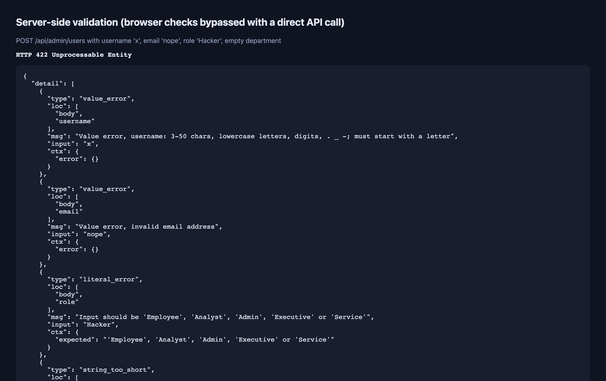

### Incident workflow: marking False Positive without a written reason is refused

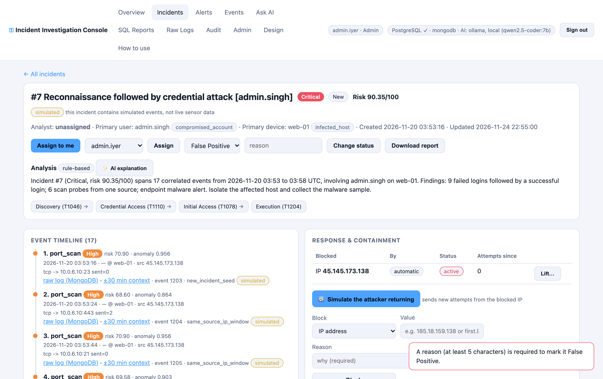

### Record action: notes shorter than 3 characters are rejected

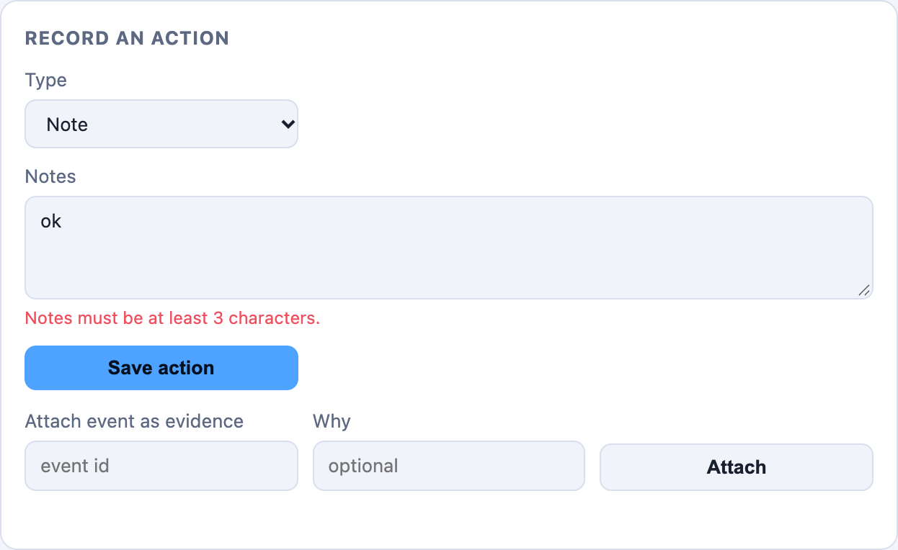

### Ask AI: 'drop table users' → only a harmless read-only query runs

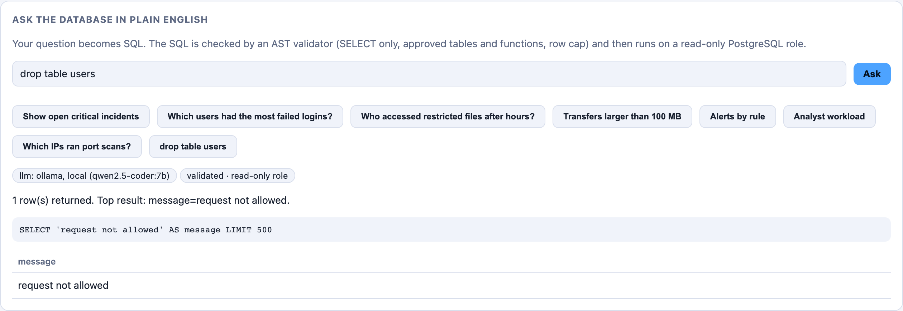

### Evidence integrity: SHA-256 of the MongoDB raw log re-checked → verified

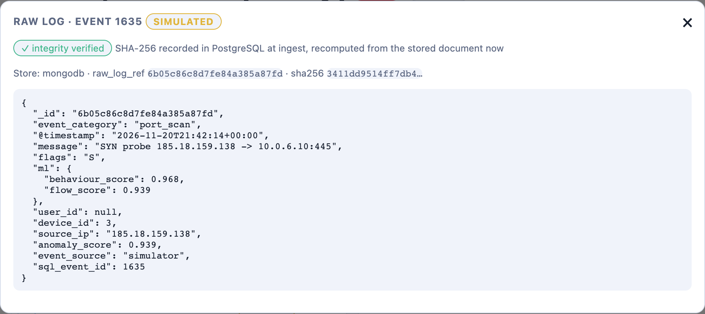

### Security self-test: 13 attacks on the system, all blocked

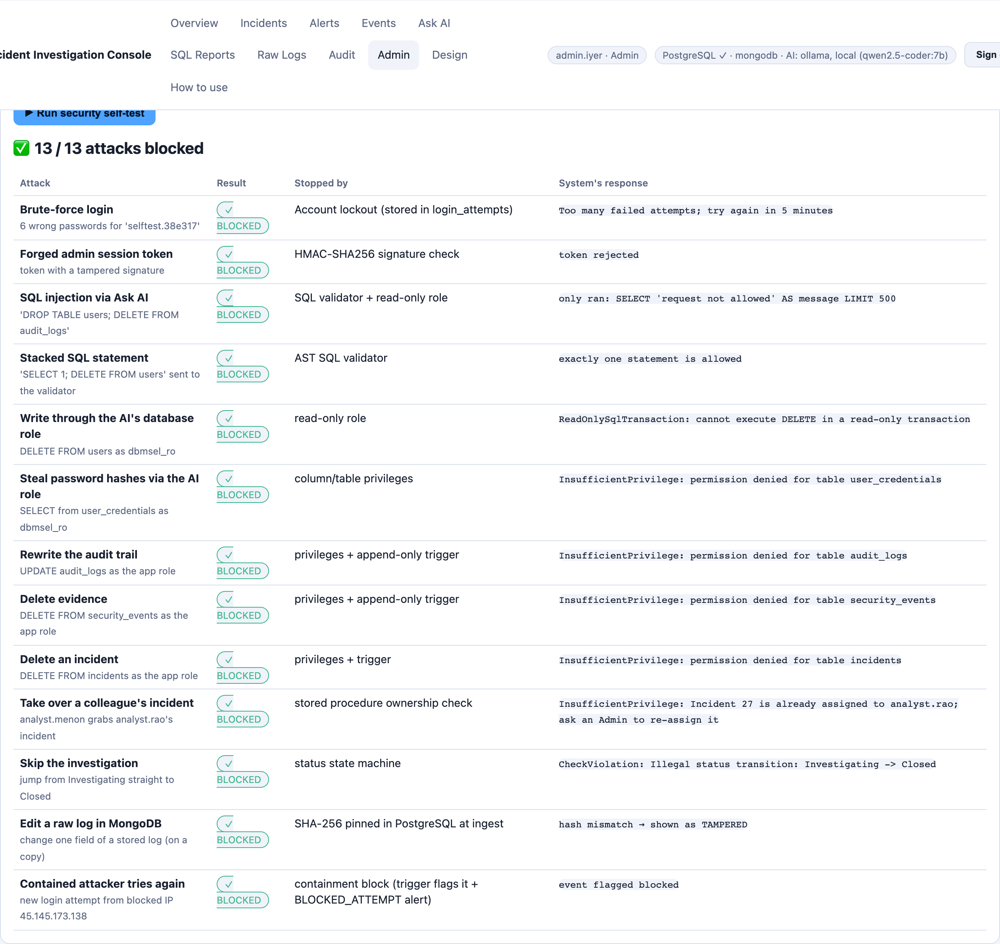

### Access control: analyst.menon cannot change, annotate or take over analyst.rao's incident

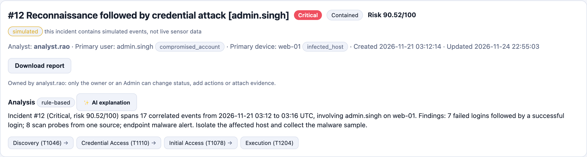
